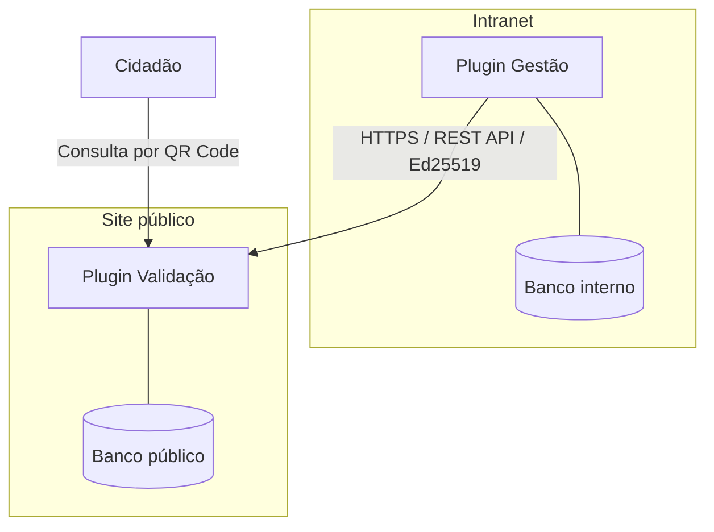

# SMTT CIF — Sistema de Carteira de Identificação Funcional

Sistema integrado de gestão, emissão e validação pública
de Carteiras de Identificação Funcional da Superintendência
Municipal de Transportes e Trânsito de Aracaju.

Atualmente implantado e em funcionamento, com dois módulos
integrados que operam em ambientes distintos: intranet
institucional e site público.

## Componentes

| Plugin | Ambiente | Versão do pacote |
| --- | --- | --- |
| [SMTT CIF — Gestão](smtt-cif-gestao/) | Intranet | 1.17.16 |
| [SMTT CIF — Validação](smtt-cif-validacao/) | Site público | 0.7.0 |

## Arquitetura

O Gestão é a fonte oficial dos dados. O Validação recebe somente a projeção pública necessária à consulta, sem acesso direto ao banco interno. A sincronização utiliza outbox transacional, processamento em segundo plano, heartbeat, reconciliação e assinatura Ed25519. A chave privada permanece no ambiente interno.

## Funcionalidades

### Gestão

- Autenticação própria e autorização por perfis.
- Cadastro de agentes, fotografia e assinatura em armazenamento privado criptografado.
- Processos administrativos, emissão, produção, entrega e ativação de CIFs.
- Registro de ocorrências, recolhimentos, relatórios e auditoria.
- Produção gráfica CR80 e exportação PDF CMYK com perfil ICC genérico, sangria e marcas de corte.
- Sincronização automática das projeções públicas.

### Validação

- Consulta pública pelo QR Code exclusivo de cada emissão.
- Recepção de projeções assinadas e armazenamento do hash do token.
- Proteção contra replay, idempotência, versionamento e limitação de tentativas inválidas.
- Separação entre homologação e produção.
- Sem pesquisa pública por nome, CPF, matrícula ou código CIF.

## Tecnologias

PHP 8.1+, WordPress, MySQL/MariaDB, JavaScript, CSS, REST API, Sodium/Ed25519 e SHA-256. Imagick é recomendado pelo plugin Gestão para tratamento de imagens.

## Instalação e integração

Cada plugin deve ser empacotado e instalado separadamente na instância WordPress correspondente. Não instale os dois ZIPs como um único plugin.

1. Configure bancos independentes e os requisitos de cada componente conforme a documentação específica.
2. Instale o Gestão na intranet e o Validação no ambiente de homologação público.
3. Gere as chaves de integração no Gestão e cadastre apenas a chave pública correspondente no Validação.
4. Configure o endereço do portal, verifique o heartbeat e teste a sincronização com dados fictícios.
5. Valide o fluxo de consulta por QR Code antes da implantação em produção. Utilize HTTPS em produção.

Documentação: [Gestão](smtt-cif-gestao/README.md) · [Validação](smtt-cif-validacao/README.md) · [Contrato de integração](smtt-cif-validacao/docs/INTEGRATION-CONTRACT.md).

## Segurança e privacidade

O ambiente público não deve armazenar CPF, biometria, documentos ou processos internos. Não publique credenciais, chaves privadas, configurações de produção, dados reais ou tokens de validação. Consulte a [política de segurança](SECURITY.md).

## Testes e versões

Os componentes incluem scripts próprios em `tests/run.php` e documentação de releases em `docs/`. As versões são independentes. O pacote Validação 0.7.0 documenta pareamento com Gestão 1.15.0; a compatibilidade operacional com Gestão 1.17.16 deve ser confirmada em homologação.

## Direitos e licenciamento

O manifesto Composer do Gestão declara licença proprietária. A publicação, redistribuição e utilização do código e dos elementos institucionais dependem de autorização dos titulares. Nenhuma licença aberta é concedida por este README.
